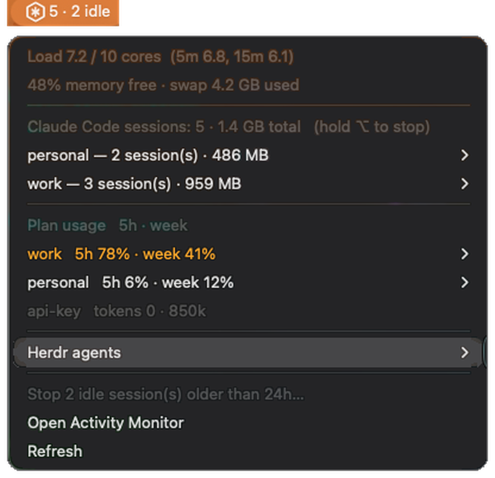

# Hivebar

See every Claude Code session on your Mac at a glance, across all your accounts, and stop the ones you don't need from the menu bar.

Hivebar is a [SwiftBar](https://swiftbar.app) plugin. When you run many coding agents at once, sessions pile up quietly: tabs you forgot about, background agents from last week, sessions still on an old CLI version. Each one holds a few hundred MB, and together they push your Mac into swap. Hivebar makes them visible and lets you stop them.



<sub>Screenshot from demo mode (`HIVEBAR_DEMO=1`): accounts and projects are made up.</sub>

## Features

- **Every session, however it was started:** interactive terminals, background agents (`claude --bg`), and sessions still running an older CLI binary.
- **Grouped by account.** If you run several Claude accounts side by side with `CLAUDE_CONFIG_DIR` (for example `~/.claude-work` and `~/.claude-personal`), each session is labelled with its account.
- **Per-session details:** project (git worktrees show as `repo ⎇ worktree`), age, memory, and CPU including child processes. Tags mark `bg`, `idle` and `old vX.Y.Z` sessions.
- **Stop sessions:**
  - **One session:** choose *Stop session* from its submenu, or hold **⌥ Option** while the menu is open to turn every row into a one-click *Stop*.
  - **A whole account:** *Stop all … sessions…*, with a confirmation dialog.
  - **Everything idle:** *Stop idle sessions older than 24h…*, with a confirmation dialog.
- **Plan usage per account:** the same 5-hour and weekly percentages as `/usage`, for every account, colored orange from 75% and red from 90%. Each account's submenu shows when its limits reset. Turn it on once with `./hivebar.30s.py setup-limits` (see below).
- **Token usage per account:** tokens used in the last 5 hours and 7 days, read from local transcripts (input + cache writes + output; cache reads are left out because they would swamp the total).
- **System health:** CPU load against your core count, free memory and swap. The icon turns orange under heavy load and red when the machine is overloaded.
- **[Herdr](https://herdr.dev) integration (optional):** if Herdr is installed, its workspaces and agent status (working, done, idle) are listed too.

Stopping sends `SIGTERM`, a normal termination signal, so Claude Code exits cleanly. Reopen the conversation later with `claude --resume`.

## Install

Requirements: macOS, Python 3.9+ (included with Xcode Command Line Tools), SwiftBar.

```sh
git clone https://github.com/steamboy/hivebar.git
cd hivebar
./install.sh          # refresh every 30s; or e.g. ./install.sh 1m
```

`install.sh` installs SwiftBar with Homebrew if it's missing and sets a plugin folder if you don't have one. It then symlinks the plugin there, so `git pull` updates it. To change the refresh interval, run `./install.sh <interval>` again. To remove Hivebar, run `./install.sh --uninstall`.

## Plan usage

Claude Code passes your plan's limit percentages to its status line. Hivebar can sit in front of your status line, keep a copy of those numbers, and then run your own status line unchanged:

```sh
./hivebar.30s.py setup-limits          # every ~/.claude* account; backs up settings.json first
./hivebar.30s.py setup-limits --undo   # put your original status lines back
```

Percentages update whenever a session in that account gets a reply, so an account you haven't used for a while shows how old its numbers are. Plans that don't report limits (API keys, for example) show token counts only.

## Settings

Open SwiftBar's plugin settings for Hivebar, or edit the `swiftbar.environment` line at the top of `hivebar.30s.py`:

| Variable | Default | Meaning |
|---|---|---|
| `HIVEBAR_STALE_HOURS` | `24` | How old an idle session must be before "Stop idle sessions" includes it |
| `HIVEBAR_IDLE_CPU` | `1.0` | CPU % (session plus its child processes) below which a session counts as idle |

## How it works

Every refresh, Hivebar reads local process information only:

- `ps` lists your own processes and finds the Claude Code CLI by its binary path, `claude` or `~/.local/share/claude/versions/*`.
- The process environment gives each session's `CLAUDE_CONFIG_DIR`, which identifies its account.
- `lsof` gives each session's working directory.
- `sysctl` and `memory_pressure` give memory and swap.
- Plan percentages come from Claude Code's status-line input, saved to `~/Library/Caches/hivebar/limits/<account>.json` (percentages and reset times only).
- Token counts come from the transcripts in `~/.claude*/projects/`. Only lines added since the last refresh are read, and running totals are cached in `~/Library/Caches/hivebar/usage.json` (token counts and file paths only, no conversation text).

**Safety checks before stopping anything.** Hivebar re-checks, at the moment you click and again after a confirmation dialog, that the process:

- is still the **same session** you saw, with the same PID and start time, so a reused PID is never hit;
- belongs to you;
- is a Claude Code session, not the background daemon, its terminal host, or one of its spare workers.

If any check fails, or the session's folder can't be determined, it does nothing.

Known limitation: a session waiting on a slow network call uses no CPU and can look idle. The confirmation dialog lists every session before anything is stopped.

Hivebar makes no network requests and sends no telemetry.

## Development

```sh
python3 -m unittest discover tests
./hivebar.30s.py                 # prints the menu as SwiftBar sees it
HIVEBAR_DEMO=1 ./hivebar.30s.py  # made-up sessions and accounts, for screenshots; actions do nothing
swift tools/make_icons.swift     # regenerates the menu-bar icons
```

## License

MIT. See [LICENSE](LICENSE).

Hivebar is an independent project. It is not affiliated with or endorsed by Anthropic. Claude and Claude Code are trademarks of Anthropic.
